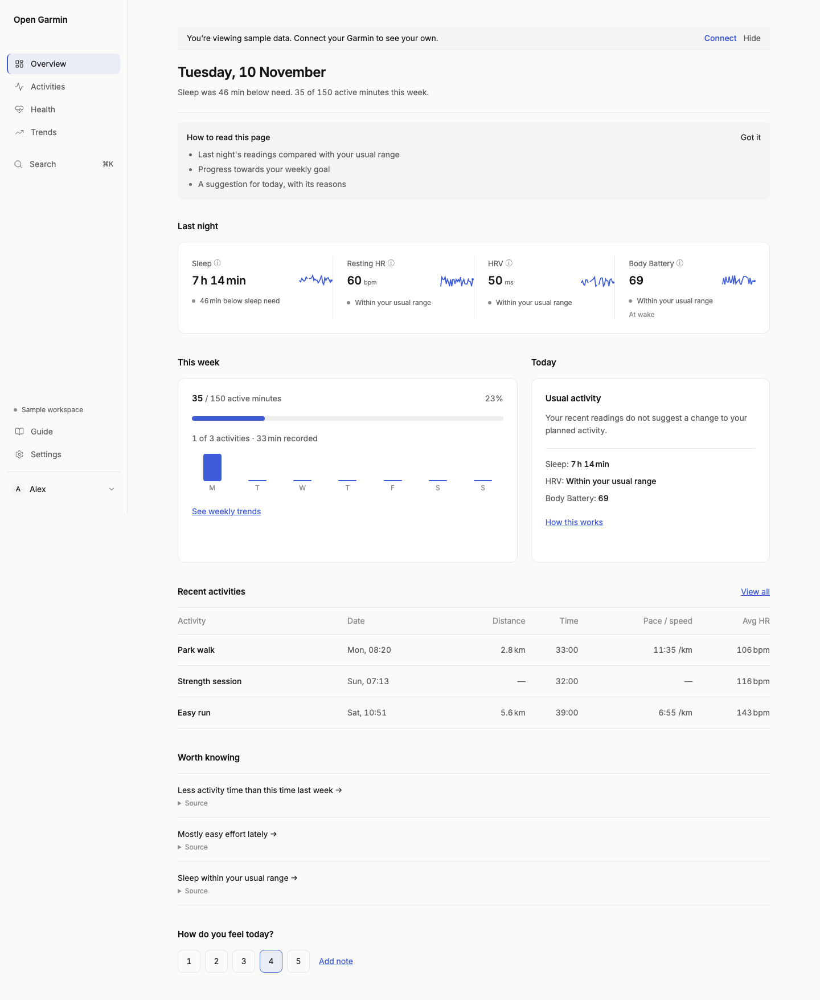

# Open Garmin

Open Garmin is a local, independent way to understand your Garmin activity and health data. **Overview** brings your latest readings, weekly goal and recent activities together. Activities, Health and Trends let you explore the evidence behind each number. The demo uses synthetic data and works without an account.



[More screenshots](docs/screenshots/v2/) · [Calculation methods](docs/METHODS.md) · [Security details](SECURITY.md)

## Start locally

Requires Python 3.12+ and Node 22.12+.

```sh
python3 -m venv .venv
.venv/bin/python -m pip install -e '.[dev]'
npm ci
npm run build
.venv/bin/uvicorn server.app:app --host 127.0.0.1 --port 8000 --no-access-log
```

Open <http://127.0.0.1:8000>. On macOS, `Start.command` starts the local workspace and opens the app after setup. Stop any other server using port 8000 before relaunching it. For frontend development, run `npm run dev` in a second terminal; Vite proxies `/api` to the Python server.

Choose **Explore sample data** to use the interactive demo. For your own workspace, use **Connect Garmin** and enter a Garmin Personal API key and region. A fresh local installation creates its workspace automatically. A hosted installation uses account sign-in.

## What you can explore

- **Overview:** last night's readings, weekly active minutes, a daily suggestion, recent activities and a private check-in.
- **Activities:** search and filter sessions, inspect routes and samples, add private notes, and compare activities.
- **Health:** Sleep, Heart, Body Battery, Stress and Steps, with missing readings shown honestly.
- **Trends:** fitness signals, weekly volume, consistency, personal records and weekly reports.
- **Guide:** plain explanations of each calculation and its research context.
- **Settings:** goals, units, heart-rate zones, Garmin connection, exports and data controls.

## Privacy and data sources

The app reads the documented Garmin Personal API. It does not write to your Garmin account. The key is encrypted on disk; tokens stay in worker memory. Notes and check-ins stay in Open Garmin. Demo data is synthetic and isolated from your workspace. Routes are drawn locally without a map tile provider.

Runtime data defaults to `.runtime/`, which is ignored by Git. You can change the location with `OPEN_GARMIN_DATA_DIR`. JSON and CSV export are available from Settings; original activity ZIPs remain available to the workspace owner. See [SECURITY.md](SECURITY.md) for hosting and data protection details.

Garmin reported values remain distinct from app calculations. Missing readings are not replaced with zero. The formulas and their minimum data requirements are documented in [docs/METHODS.md](docs/METHODS.md), generated from the `/api/methods` registry. Research references are listed in the in-app Guide and the `research/` directory.

Open Garmin is not affiliated with, endorsed by, or sponsored by Garmin. Garmin and Garmin Connect are trademarks of Garmin Ltd. or its subsidiaries.

## Verify the project

```sh
.venv/bin/python -m pytest -q
.venv/bin/ruff check server tests
npm test
npm run lint
npm run contrast
npm run check:ui
npm run build
npx playwright test
```

Playwright starts a disposable server and uses only synthetic demo data. The current visual review set is in `docs/screenshots/v2/`.

To inspect an existing local workspace without syncing or changing data, run
`.venv/bin/python scripts/validate_live.py`. It reports coverage counts and sections
without usable data, without printing personal measurements.
